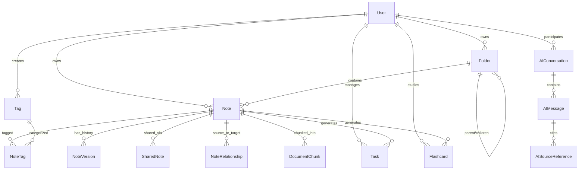

# Short Notes 2.0 — Database Design & Schema Evolution

**Document Version:** 1.0.0  
**Database Engine:** PostgreSQL 14+ with pgvector support  
**ORM:** Prisma 5.22.0  

---

## 1. Schema Design Principles

1. **Zero Data Loss:** Migrations must preserve all existing user data in `users`, `notes`, `folders`, and `shared_notes`.
2. **Strict Multi-Tenancy:** Every entity (notes, folders, tags, tasks, conversations) must be directly or indirectly linked to a `userId`, and queries must enforce user ownership.
3. **Normalized Tagging:** Tags must be user-scoped (`unique([userId, name])`), eliminating cross-user namespace collisions.
4. **Hierarchical Folders:** Folders must support a self-referential `parentId` with `onDelete: Cascade` or `SetNull` to enable unlimited folder nesting.
5. **Knowledge Graph & Backlinks:** First-class relationship modeling with `NoteRelationship` for bi-directional links, references, and dependencies.
6. **AI Grounding & Vector Storage:** Document chunking and embedding tables to power accurate RAG and semantic search.

---

## 2. Entity-Relationship Model

---

## 3. Data Dictionary

### 3.1 Core Note & Knowledge Entities
- **`Folder` (Updated):**
  - `id`: String (CUID)
  - `name`: String
  - `color`: String (default `"blue"`)
  - `icon`: String? (optional emoji/icon)
  - `parentId`: String? (self-relation to parent Folder)
  - `userId`: String (relation to User)
  - `createdAt`, `updatedAt`: DateTime
  - *Indexes:* `[userId]`, `[parentId]`, `unique([userId, name, parentId])`

- **`Tag` (Updated to User-Scoped):**
  - `id`: String (CUID)
  - `name`: String
  - `color`: String? (default `"gray"`)
  - `userId`: String (relation to User)
  - `createdAt`: DateTime
  - *Indexes:* `unique([userId, name])`

- **`Note` (Enhanced):**
  - `id`: String (CUID)
  - `title`: String
  - `content`: String (Text / Markdown)
  - `originalText`: String (Text)
  - `summary`: String? (Text)
  - `bulletPoints`: String[]
  - `noteType`: String (default `"quick"`, e.g. `"research"`, `"meeting"`, `"lecture"`, `"project"`)
  - `sourceType`: String (default `"manual"`, `"pdf"`, `"word"`, `"text"`, `"web"`)
  - `fileName`: String?
  - `fileSize`: Int?
  - `isPinned`: Boolean (default `false`)
  - `isFavorite`: Boolean (default `false`)
  - `isArchived`: Boolean (default `false`)
  - `color`: String?
  - `sentiment`: String?
  - `wordCount`: Int (default 0)
  - `readingTime`: Int (default 0)
  - `folderId`: String? (relation to Folder)
  - `userId`: String (relation to User)
  - `createdAt`, `updatedAt`: DateTime
  - `deletedAt`: DateTime? (soft delete timestamp)
  - *Indexes:* `[userId]`, `[folderId]`, `[userId, isPinned, createdAt]`, `[deletedAt]`

- **`NoteRelationship` (New for Knowledge Graph & Backlinks):**
  - `id`: String (CUID)
  - `sourceNoteId`: String (relation to Note)
  - `targetNoteId`: String (relation to Note)
  - `relationshipType`: String (default `"references"`, `"related_to"`, `"depends_on"`, `"contradicts"`)
  - `context`: String? (snippet of linking text)
  - `createdAt`: DateTime
  - *Indexes:* `[sourceNoteId]`, `[targetNoteId]`, `unique([sourceNoteId, targetNoteId, relationshipType])`

### 3.2 AI & RAG Retrieval Entities
- **`DocumentChunk` (New):**
  - `id`: String (CUID)
  - `noteId`: String (relation to Note)
  - `userId`: String (for fast tenant filtering)
  - `chunkIndex`: Int
  - `content`: String (Text)
  - `tokenCount`: Int
  - `embedding`: Unsupported("vector(1536)")? or Float[]
  - `createdAt`: DateTime
  - *Indexes:* `[noteId]`, `[userId]`

- **`AIConversation` (New):**
  - `id`: String (CUID)
  - `title`: String (e.g. "Research on Next.js 14")
  - `userId`: String (relation to User)
  - `scope`: String (default `"all"`, `"folder"`, `"note"`)
  - `scopeId`: String? (optional noteId or folderId)
  - `createdAt`, `updatedAt`: DateTime
  - *Indexes:* `[userId]`, `[updatedAt]`

- **`AIMessage` (New):**
  - `id`: String (CUID)
  - `conversationId`: String (relation to AIConversation)
  - `role`: String (`"user"`, `"assistant"`, `"system"`)
  - `content`: String (Text)
  - `tokens`: Int?
  - `createdAt`: DateTime
  - *Indexes:* `[conversationId]`

- **`AISourceReference` (New for Traceable Citations):**
  - `id`: String (CUID)
  - `messageId`: String (relation to AIMessage)
  - `noteId`: String (relation to Note)
  - `snippet`: String (Text)
  - `citationNumber`: Int
  - `createdAt`: DateTime
  - *Indexes:* `[messageId]`, `[noteId]`

### 3.3 Productivity & Study Mode Entities
- **`Task` (New):**
  - `id`: String (CUID)
  - `title`: String
  - `description`: String?
  - `status`: String (default `"todo"`, `"in_progress"`, `"done"`)
  - `priority`: String (default `"medium"`, `"low"`, `"high"`, `"urgent"`)
  - `dueDate`: DateTime?
  - `noteId`: String? (source note reference)
  - `userId`: String (relation to User)
  - `createdAt`, `updatedAt`: DateTime
  - *Indexes:* `[userId, status]`, `[noteId]`

- **`Flashcard` (New):**
  - `id`: String (CUID)
  - `front`: String (Question / Prompt)
  - `back`: String (Answer / Explanation)
  - `difficulty`: Float (default 2.5, for FSRS/SM-2)
  - `interval`: Int (default 0, days until next review)
  - `repetition`: Int (default 0)
  - `dueDate`: DateTime (default `now()`)
  - `noteId`: String? (source note reference)
  - `userId`: String (relation to User)
  - `createdAt`, `updatedAt`: DateTime
  - *Indexes:* `[userId, dueDate]`, `[noteId]`

---

## 4. Migration Safety Strategy

1. **Additive Schema Updates:** New tables and optional columns are added non-destructively.
2. **Default Values:** All new columns have default values or are optional (`String?`) to prevent constraint violations on existing records.
3. **Preservation of Note History:** Existing `notes` records remain untouched; existing `NoteVersion` records remain linked.
4. **Prisma Safe Deployment:** Uses `prisma db push` during development and structured SQL migrations (`prisma migrate dev`) for production tracking.

