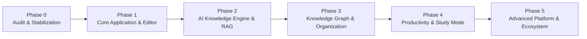

# Short Notes 2.0 — Implementation Roadmap

**Document Version:** 1.0.0  
**Methodology:** Incremental delivery in dependency order. No skipping stabilization.  

---

## 1. Roadmap Overview & Timeline

---

## 2. Phase Breakdown

### Phase 0: Repository Audit and Stabilization (Current Phase)
- [x] Complete comprehensive 15-point repository audit (`docs/PROJECT_AUDIT.md`).
- [x] Feature verification matrix (`docs/FEATURE_MATRIX.md`).
- [x] Security audit & vulnerability report (`docs/SECURITY_AUDIT.md`).
- [x] Architecture design & data dictionary (`docs/SYSTEM_ARCHITECTURE.md`, `docs/DATABASE_DESIGN.md`).
- [x] Safe database migration plan (`docs/DATABASE_MIGRATIONS.md`).
- [x] Testing strategy specification (`docs/TESTING_STRATEGY.md`).
- [x] Fix critical `.gitignore` secret leakage vulnerability.
- [ ] Install test runner (Vitest) and set up basic unit/integration test harness.
- [ ] Fix high-severity route crashes and 404 redirects (BUG-01, BUG-02, BUG-03).

### Phase 1: Core Application & Note Experience
- **Objective:** Turn the broken prototype into a rock-solid, fully functioning note-taking system.
- **Milestones:**
  1. **Fix All Navigation & Route 404s:**
     - Correct auth redirect to `/login`.
     - Implement `/dashboard/notes/[id]` (Note Editor & Detail Page).
     - Implement `/dashboard/folders` (Folder management with create/edit/delete).
     - Implement `/dashboard/settings` (User settings, theme, AI configuration).
     - Implement public share route `/share/[token]`.
  2. **Comprehensive Dashboard Home (`/dashboard`):**
     - Welcome hero with personalized stats.
     - Quick capture widget directly on dashboard.
     - Recent notes carousel/grid with pin indicators.
     - Pinned notes quick-access shelf.
     - Storage and usage overview card.
  3. **Professional Note Editor:**
     - Clean, focused editing interface with live Markdown preview or rich-text toolbar.
     - Real-time word count and reading time.
     - Visible autosave state indicators (*Saving...*, *Saved*, *Error*).
     - Debounced autosave with conflict prevention.
  4. **Robust API & Soft Delete / Trash:**
     - Update `/api/notes` to decouple note creation from mandatory OpenAI call. Notes save instantly; AI summarization occurs as a progressive enhancement or on-demand.
     - Implement soft delete (`deletedAt`) in `DELETE /api/notes/[id]`.
     - Add trash route (`/dashboard/trash`) to list, restore, or permanently purge deleted notes.
     - Add `PUT` and `DELETE` endpoints to `/api/folders`.
     - Fix `src/app/dashboard/notes/page.tsx` data parsing bug. Remove dead `page-improved.tsx`.
  5. **Automated Test Suite:**
     - Configure Vitest with unit tests for API handlers, helpers, parsers, and exporters.
     - Verify all Phase 1 features pass tests before proceeding.

### Phase 2: AI Knowledge Intelligence & RAG
- **Objective:** Implement conversational AI grounded in the user's personal knowledge base.
- **Milestones:**
  1. **Embeddings & Vector Indexing:**
     - Document chunker with semantic splitting.
     - Vector embeddings generation via OpenAI `text-embedding-3-small`.
     - Cosine similarity search over document chunks in PostgreSQL.
  2. **Streaming AI Chat with Notes (`/dashboard/ai`):**
     - Streaming response route handler (`POST /api/ai/chat`).
     - Persistent multi-turn conversations (`AIConversation`, `AIMessage`).
     - Scoped chat (All notes vs specific folder vs current note).
  3. **Traceable Citations & Passage Highlighting:**
     - Numbered citation pills linking directly to source notes.
     - Snippet quotes extracted directly from retrieved chunks.
  4. **Advanced Semantic Search:**
     - Unified global search modal (`Cmd+K`).
     - Hybrid keyword + semantic vector retrieval.

### Phase 3: Knowledge Management & Graph
- **Objective:** Visual connections, bi-directional links, and intelligent organization.
- **Milestones:**
  1. **Interactive Knowledge Graph (`/dashboard/graph`):**
     - Force-directed graph visualization using D3/SVG.
     - Interactive node expansion, tag clustering, and direct note opening.
  2. **Bi-directional Internal Links & Backlinks:**
     - Note syntax `[[Note Title]]` auto-completes and records `NoteRelationship`.
     - Backlinks panel at the bottom of the note editor showing referring notes.
  3. **Hierarchical Folders & Note Types:**
     - Unlimited folder nesting in sidebar navigation.
     - Specialized templates (Research Note, Meeting Note, Lecture Note).

### Phase 4: Productivity & Study Mode
- **Objective:** Transform knowledge into action items and learning mastery.
- **Milestones:**
  1. **Integrated Task Management (`/dashboard/tasks`):**
     - Extract tasks from notes or create standalone tasks.
     - Kanban board and list view with priority, due date, and status.
  2. **AI Flashcards & Spaced Repetition (`/dashboard/study`):**
     - Generate flashcards from notes.
     - Interactive review session powered by FSRS / SM-2 spaced repetition.
  3. **Quizzes & Mock Exams:**
     - Multiple-choice and short-answer question generator with instant feedback.

### Phase 5: Advanced Platform & Ecosystem
- **Objective:** Enterprise readiness, developer APIs, and offline experience.
- **Milestones:**
  1. **Authenticated MCP Server:**
     - Multi-tenant API key handshake in `notesmcp`.
  2. **Developer REST API:**
     - Key management and rate limiting for external integrations.
  3. **Offline-First PWA:**
     - Service worker caching and IndexedDB offline note editing with background sync.

