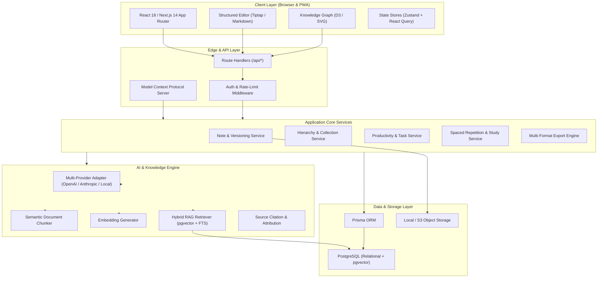

# Short Notes 2.0 — System Architecture

**Document Version:** 1.0.0  
**Architect:** Principal Software Architect  
**Target Platform:** Next.js 14 App Router, PostgreSQL, Prisma, Tailwind CSS  

---

## 1. High-Level Architecture Overview

Short Notes 2.0 is designed around a modular, layered clean architecture:



---

## 2. Layer Responsibilities & Design Patterns

### 2.1 Presentation Layer (`src/app` & `src/components`)
- **App Router Layouts:**
  - `(auth)`: Unauthenticated shell for login, registration, and onboarding.
  - `dashboard`: Authenticated workstation providing persistent sidebar navigation, search drawer, quick capture modal, and theme control.
  - `share/[token]`: Public read-only view with metadata preview and responsive layout.
- **Component Architecture:**
  - Radix UI primitives styled with Tailwind CSS for accessible, accessible interactions.
  - Granular UI error boundaries to prevent page crashes.
  - Optimistic UI updates for note favorites, pinning, and folder moves.

### 2.2 API & Business Logic Layer (`src/app/api` & `src/lib/services`)
- **API Handler Pattern (`apiHandler`):**
  - Centralized authentication check via `getServerSession(authOptions)`.
  - Zod payload validation with structured JSON errors.
  - Unified JSON response shape:
    ```json
    {
      "success": true,
      "data": { ... },
      "meta": { "timestamp": "...", "requestId": "..." }
    }
    ```
- **Service Layer Isolation:**
  - Database queries and complex business logic reside in dedicated services (`src/lib/services/*`) rather than being inline inside route handlers.

### 2.3 AI Provider Abstraction (`src/lib/ai/*`)
- **Provider-Independent Adapter Interface:**
  ```typescript
  export interface AIProvider {
    generateCompletion(prompt: string, options?: CompletionOptions): Promise<string>;
    streamCompletion(messages: Message[], options?: StreamOptions): Promise<ReadableStream>;
    generateEmbeddings(texts: string[]): Promise<number[][]>;
    summarize(text: string, style?: string): Promise<AISummaryResult>;
  }
  ```
- **Fallback & BYOK:**
  - Allows users to supply their personal OpenAI, Anthropic, or compatible API keys in settings.
  - Graceful fallback: If AI keys are not configured or quota is exhausted, manual note creation and local search continue to work without disruption.

### 2.4 RAG & Hybrid Retrieval Engine
1. **Document Ingestion:**
   - Text extracted via parsers (`pdf-parse`, `mammoth`, `text`).
   - Split into overlapping semantic chunks (e.g. 500 tokens with 50 token overlap).
2. **Indexing:**
   - Generate embeddings (e.g., OpenAI `text-embedding-3-small`, 1536 dimensions).
   - Stored in PostgreSQL with `pgvector` index or hybrid cosine similarity.
3. **Retrieval:**
   - User query converted to vector embedding + full-text search tokens.
   - Reciprocal Rank Fusion (RRF) combines semantic vector similarity and PostgreSQL full-text search scores.
   - Top-K chunks assembled into context window with explicit note IDs and titles.
4. **Attribution:**
   - Generation model produces answers referencing `[^1]`, `[^2]` citation markers.
   - Citation engine resolves markers to clickable note citations with preview popovers.

---

## 3. Technology Choices & Justification

| Technology | Role | Justification |
|---|---|---|
| **Next.js 14 (App Router)** | Framework | Server-side rendering, streaming route handlers, React Server Components, unified API and frontend. |
| **PostgreSQL** | Database | ACID compliance, robust indexing, relational data integrity, native full-text search, and `pgvector` support. |
| **Prisma ORM** | Data Access | Type-safe queries, migration management, schema declaration. |
| **Tailwind CSS & Radix** | Styling & UI | Design flexibility, small bundle size, WCAG AA accessibility primitives. |
| **Zod** | Validation | Strict schema validation at API boundaries and environment boundaries. |
| **Zustand** | Client State | Lightweight state management for active editor state, sidebar toggles, and search filters. |

